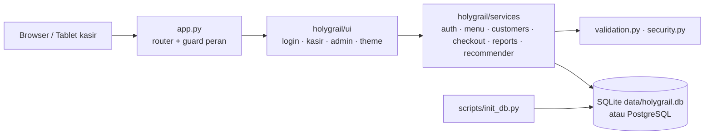
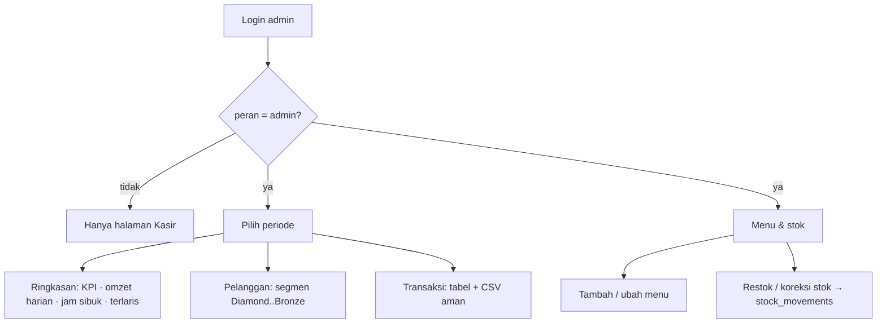
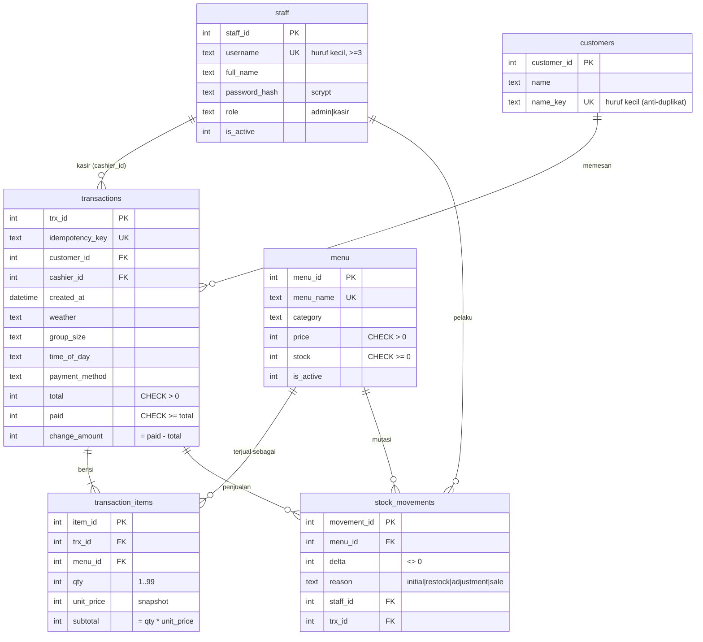

# Arsitektur Holy Grail POS

## Gambaran umum

Aplikasi monolit Streamlit dengan tiga lapisan satu arah: **UI → services → database**.



Aturan: `services/` tidak mengimpor Streamlit (bisa diuji tanpa UI); `ui/` tidak menulis SQL.

## Alur transaksi kasir

```mermaid
sequenceDiagram
    actor K as Kasir
    participant UI as ui/kasir.py
    participant C as services/checkout.py
    participant DB as Database
    K->>UI: pilih menu, isi nama, pilih metode bayar
    UI->>UI: keranjang = {menu_id: qty} (tanpa harga)
    K->>UI: klik Bayar
    UI->>C: checkout(lines, nama, metode, uang, idempotency_key)
    C->>DB: BEGIN
    C->>DB: kunci idempotensi sudah ada?
    alt sudah ada
        DB-->>C: trx lama
        C-->>UI: nota yang sama (tidak ada transaksi ganda)
    else baru
        C->>DB: cari/buat pelanggan
        C->>DB: baca harga & status menu (server-side)
        C->>C: total; tunai: uang ≥ total, lainnya: pas
        C->>DB: INSERT transactions
        loop tiap menu
            C->>DB: UPDATE menu SET stock=stock-qty WHERE stock>=qty
            alt rowcount = 0
                C-->>UI: StockError → ROLLBACK semua
            end
            C->>DB: INSERT transaction_items (snapshot harga) + stock_movements
        end
        C->>DB: COMMIT
        C-->>UI: Receipt
    end
    UI-->>K: nota + unduh .txt
```

## Alur admin



## ERD



Constraint penting (diuji di `tests/integration/test_checkout_and_db.py`): `UNIQUE(trx_id, menu_id)` mencegah baris item ganda; `ON DELETE RESTRICT` pada menu & pelanggan agar riwayat tidak yatim; `CHECK` menjaga stok tidak negatif dan total/kembalian konsisten **di level database**, bukan hanya di aplikasi. DDL lengkap: [schema.sql](schema.sql).

## Keputusan desain

| Keputusan | Alasan |
|---|---|
| SQLite default, PostgreSQL opsional | File tunggal mudah dibuka di DBeaver & dijalankan siapa pun; SQLAlchemy Core + tipe portabel menjaga jalur ke PostgreSQL |
| Uang = integer rupiah | Menghindari galat floating point |
| Harga dibaca server-side + snapshot | Klien tidak bisa memalsukan harga; riwayat tidak berubah saat harga diubah |
| Stok via `UPDATE … WHERE stock >= qty` | Atomik pada SQLite & PostgreSQL; terbukti oleh tes 6 checkout bersamaan pada stok 3 (tepat 3 berhasil) |
| Idempotency key per keranjang | Refresh/klik ganda tidak membuat transaksi ganda |
| `scrypt` stdlib untuk password | Tanpa dependensi tambahan; parameter tersimpan di hash sehingga bisa dinaikkan nanti |
| Rekomendasi berbasis aturan + riwayat | Transparan (setiap saran punya alasan), deterministik, bisa diuji; menggantikan model TensorFlow/pickle lama yang berat dan tidak aman dimuat |
| Segmentasi tetap berbasis ambang total belanja | Mudah dijelaskan ke pemilik toko; ambang di `reports.SEGMENT_TIERS` |
| Design system "nota warung" | Terang & kontras tinggi untuk kafe; angka tabular; target sentuh 44px; token di `ui/theme.py` diuji kontrasnya |

## Batasan (jujur)

- Pembatas login hanya per sesi browser; penyerang yang membuka sesi baru tidak tertahan. Untuk produksi: pembatas di server/reverse proxy.
- Belum ada HTTPS bawaan, 2FA, manajemen akun staf lewat UI, audit log akun, atau retur/void transaksi.
- SQLite = satu penulis pada satu waktu; cukup untuk satu toko, bukan multi-cabang.
- Saran menu bukan model ML; kualitasnya bergantung pada riwayat penjualan yang ada (data demo fiktif).
- E2E tanpa browser sungguhan; tidak ada tes regresi visual.
- `legacy/models/*.pkl` hanya arsip; jangan dimuat dengan `pickle`.
